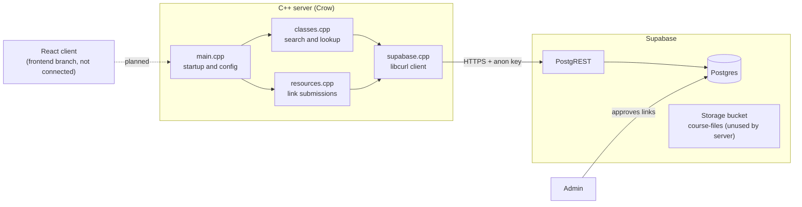
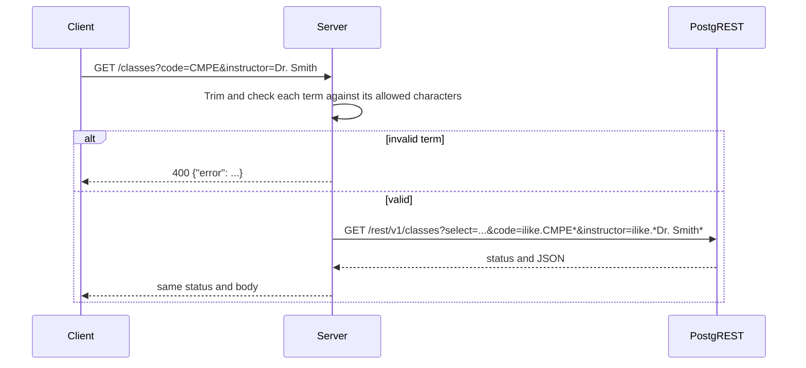
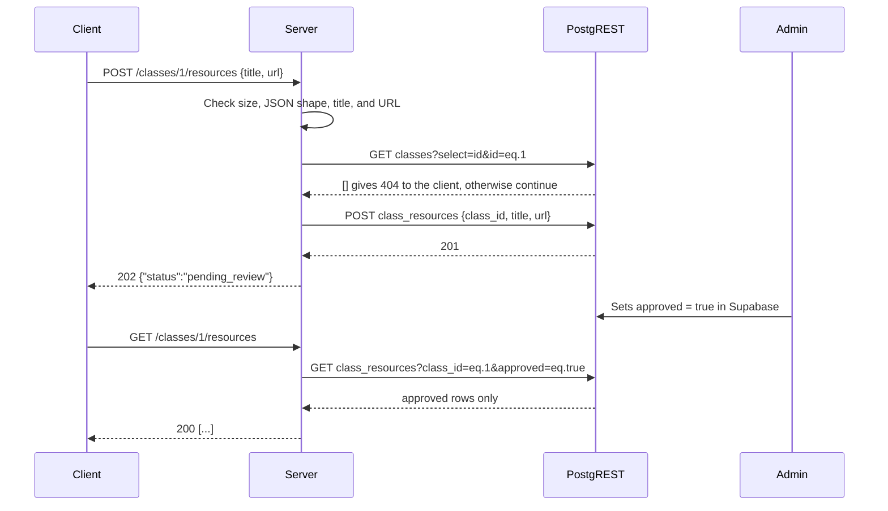
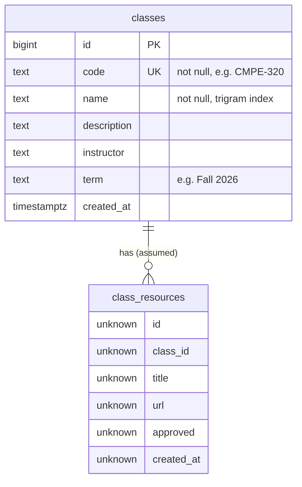

# System Architecture

How the system is built today. For the reasoning, API contract, and open problems, see [DESIGN_DOC.md](DESIGN_DOC.md).

Snapshot: `main` at `f5e14751` (2026-10-27), written 2026-11-04.

## Overview

A course resource-sharing site for Queen's University. Students look up classes and submit links to resources. Submitted links stay hidden until an admin approves them.

| Layer | Technology | Where it lives | State |
| --- | --- | --- | --- |
| API server | C++17, Crow v1.2.1, libcurl | repo root on `main` | Working |
| Data | Supabase (Postgres, PostgREST, Storage) | `supabase/` on `main` | Partly defined; see [gaps](DESIGN_DOC.md#known-gaps) |
| Web client | React 19, Vite | `Front_end/` on `frontend@origin` | Static shell, not merged, makes no API calls |
| User accounts | Argon2id, jwt-cpp, OpenSSL | `auth.cpp`, uncommitted in the working copy | Working; no existing route requires it yet |



The server stores nothing itself. It validates requests, translates them into PostgREST queries, and relays the results. Every database call goes through HTTP, so there is no Postgres driver or connection pool.

## Source layout

| Path | Responsibility |
| --- | --- |
| `main.cpp` | Reads environment variables, initializes libcurl, registers routes, starts Crow |
| `classes.cpp`, `classes.h` | `GET /classes` and `GET /classes/<id>`; the `SEARCH_FIELDS` table (`classes.cpp:32`) defines what is searchable |
| `resources.cpp`, `resources.h` | `GET` and `POST /classes/<id>/resources`; title and URL validation |
| `auth.cpp`, `auth.h` | `/auth/*` routes, password hashing, tokens, and `authenticate()` for protecting routes |
| `supabase.cpp`, `supabase.h` | `supabase_get`, `supabase_post`, `supabase_delete`, `SupabaseConfig`, and the shared `json_error` helper |
| `backend/supabase/migrations/` | Database schema, seed rows, and storage bucket |
| `supabase/config.toml` | Local Supabase stack configuration (Supabase CLI defaults, Postgres 17) |
| `CMakeLists.txt`, `Dockerfile` | Build and container image |

Features register themselves through a `register_*_routes(app, cfg)` function called from `main.cpp`. A new feature follows the same pattern: add a source file, add it to `add_executable`, and add the call in `main`.

## Request flows

### Search



Filters are ANDed. `q` is the exception: it becomes a PostgREST `or=(...)` group across `name`, `code`, and `instructor`. Terms are percent-encoded before being added to the query. Results are sorted by name and capped at 100 rows.

### Link submission



The server never sends `approved`; it relies on the column defaulting to false. There is no admin API, so approval happens directly in Supabase.

## Data model



- **`classes`:** created by `20261020214030_create_classes.sql` with four sample rows. Row-level security (RLS) is on, and `anon` can only read.
- **`class_resources`:** the code reads and writes it, but **no migration or revision in the repo's history defines it**. The columns above are just the ones the code uses. Their types, the foreign key, and the `approved` default are unknown.
- **`users` and `refresh_tokens`:** created by `20261104000000_create_auth_tables.sql`. Only `service_role` can access them; `anon` and `authenticated` have no grants. Passwords are stored as Argon2id hashes and refresh tokens as SHA-256 hashes. Expired refresh tokens stay in the table until something cleans them up.
- **`course-files` storage bucket:** private. Signed-in users may upload if the first folder in the path is numeric. No policy allows reading files back, and no server route uses the bucket.

## Concurrency and failure handling

- Crow runs in `multithreaded()` mode. Each Supabase call creates its own curl handle, and the only shared state is the read-only `SupabaseConfig`.
- Supabase calls block a worker thread for up to 10 seconds. A `POST` makes two calls, so it can block for up to 20.
- Status `0` from `supabase_get` or `supabase_post` means Supabase couldn't be reached, and the route returns `502`.
- There are no retries, caching, or rate limits.

## Configuration

| Variable | Required | Default | Purpose |
| --- | --- | --- | --- |
| `SUPABASE_URL` | Yes | None | Base URL of the Supabase project |
| `SUPABASE_ANON_KEY` | Yes | None | Sent as both `apikey` and `Authorization: Bearer` |
| `SUPABASE_SERVICE_ROLE_KEY` | Yes | None | Used only by the auth routes; never expose it to a client |
| `JWT_SECRET` | Yes | None | Signs access tokens; at least 32 characters (`openssl rand -hex 32`) |
| `PORT` | No | `8080` | Listening port; a non-numeric value crashes the server at startup |

If a required variable is missing, or `JWT_SECRET` is too short, the server prints an error and exits with status 1. Changing `JWT_SECRET` invalidates all access tokens.

## Build and run

Standard build:

```sh
cmake -S . -B build
cmake --build build
SUPABASE_URL=... SUPABASE_ANON_KEY=... SUPABASE_SERVICE_ROLE_KEY=... JWT_SECRET=... ./build/server
```

jwt-cpp and Argon2 are downloaded at configure time. OpenSSL must already be installed (`libssl-dev` on Debian, `brew install openssl@3` on macOS).

**On this Mac, the standard build fails** for two reasons:

1. `find_package(CURL CONFIG REQUIRED)` needs a `CURLConfig.cmake`, which neither the macOS SDK nor Homebrew's curl provides here. Removing `CONFIG` fixes this.
2. Homebrew's Asio 1.38.2 no longer has `asio::io_service`, which Crow v1.2.1 uses. Building against Asio 1.30.2 works.

With a copy of the sources in another directory, these steps produced a working binary:

```sh
git clone --depth 1 --branch asio-1-30-2 https://github.com/chriskohlhoff/asio.git /path/to/asio
# In the copy's CMakeLists.txt: find_package(CURL REQUIRED)
cmake -S . -B build \
  -DCMAKE_CXX_FLAGS="-isystem /path/to/asio/asio/include" \
  -DASIO_INCLUDE_DIR=/path/to/asio/asio/include \
  -DOPENSSL_ROOT_DIR="$(brew --prefix openssl@3)"
cmake --build build -j8
```

**Docker:** the `Dockerfile` builds from `gcc:latest` and runs `./build/server`. Pass the variables at runtime with `-e` and publish the port with `-p`. This image has not been built during this review because the Docker daemon wasn't running. The floating base image also leaves its Asio and curl versions unpinned, and with no `.dockerignore`, `COPY . .` includes the local `build/` and nested repository.

**Local Supabase:** `supabase start` should run the stack on the ports in `config.toml` (API 54321, database 54322, Studio 54323). The Supabase CLI isn't installed on this machine, so this and the migrations are unverified.

## Repository layout and branches

The repository uses Jujutsu (`jj`), and the root has no colocated `.git`.

| Name | Contents |
| --- | --- |
| `main` | Backend and Supabase; the working copy is an empty change on top of it |
| `frontend@origin`, `tess_frontend@origin` | Same commit: the Sept base plus `Front_end/`, including a committed `node_modules/` |
| `kynzksru` (on `zssutnyp`) | Earlier, unfinished auth module on the Sept base; the working copy's `auth.cpp` was written separately and doesn't depend on it |
| `ruyquoks` | Local undescribed change on `main` containing only `build/` output and a `.DS_Store` (445 files) |

There are two remotes and two checkouts:

- **Root:** `origin` is `github.com:SimonNRisk/CMPE-320`.
- **`queens-notesharing-platform/`:** a separate nested repository whose `origin` is the course GitLab (`gitlab.caslab.queensu.ca`, `f26-cisc-cmpe-3201/group-5`). Its project files currently match the root's, and the root repository doesn't track it.

There is also no root `.gitignore`, which is how build output and `node_modules/` can end up in changes.
